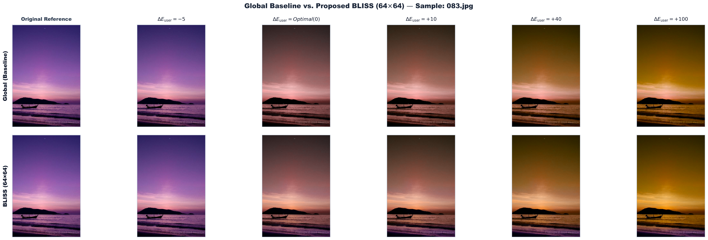

# BLISS: Blue Light Interpolated Spatial Smoothing

[](https://www.python.org/downloads/)
[](LICENSE)
[](notebooks/BLISS_Experiments_and_Results.ipynb)

Official implementation of **BLISS (Blue Light Interpolated Spatial Smoothing)**, a spatially-adaptive, content-aware software blue light reduction framework operating in the conical **RGb** color space.

---

## Overview & Motivation

High-energy short-wavelength blue light emitted by digital displays contributes to visual fatigue and circadian rhythm disruption. Existing color-adaptive filtering approaches transform the standard RGB cube into a conical **RGb** space by selecting a single optimal transformation matrix globally across the entire image. However, global matrix selection struggles in heterogeneous scenes (e.g., images combining bright skies, white-dominant backgrounds, and natural subjects).

**BLISS** overcomes this limitation by transitioning from global uniform filtering to **spatially-aware local adaptation**:
1. **Local Grid Optimization:** Partitions the input frame into spatial grid blocks (e.g., $32 \times 32$ or $64 \times 64$) and determines the optimal RGb transformation matrix for each local region.
2. **Bilinear Matrix Smoothing:** Applies bilinear spatial interpolation across the discrete matrix decision grid prior to pixel-level filtering, completely eliminating grid blocking artifacts while preserving sharp image edges and structural fidelity.
3. **Tunable Attenuation Control:** Retains full user customizability via the $\Delta E_{\text{user}}$ control parameter, spanning conservative color preservation ($\Delta E_{\text{user}} = -5$), balanced optimal attenuation ($\Delta E_{\text{user}} = 0$), and enhanced blue-light suppression ($\Delta E_{\text{user}} \in \{+10, +40, +100\}$).

---

## Qualitative Visual Comparison

Side-by-side comparison between the **Global Baseline** (top row) and the proposed **BLISS ($64 \times 64$)** method (bottom row) across increasing filter intensity thresholds ($\Delta E_{\text{user}}$):



---

## Methodology Pipeline

For an input RGB image $I \in \mathbb{R}^{H \times W \times 3}$ and a spatial grid block size $B \times B$:

1. **Block-Level Matrix Selection:** For each spatial block, BLISS evaluates the four canonical RGb transformation vectors $F_c \in \{[-1, 0.5, 0.5], [0.5, -1, 0.5], [0, -1, 1], [-1, 0, 1]\}$ and selects the matrix maximizing positive blue-channel attenuation energy $T = \max(0, F_c \cdot [R, G, B]^T)$.
2. **Spatial Matrix Field Interpolation:** The resulting coarse decision grid $G \in \mathbb{R}^{\lceil H/B \rceil \times \lceil W/B \rceil \times 3}$ is upsampled to full image resolution $(H, W)$ via **Bilinear Interpolation** (`cv2.INTER_LINEAR`), yielding a continuous, spatially smooth transformation field $\tilde{F}(x, y)$.
3. **Adaptive Gain Scaling ($f_c$):** The global gain factor $f_c$ is computed from the mean attenuation map $\Delta E_{\text{image}} = \text{mean}(T_{\text{map}})$ and the user-defined threshold $\Delta E_{\text{user}}$:

```math
f_c = \begin{cases}
\dfrac{|\Delta E_{\text{user}}|}{\Delta E_{\text{image}}}, & \text{if } \Delta E_{\text{user}} < 0 \text{ and } \Delta E_{\text{image}} > |\Delta E_{\text{user}}| \\
1.0 + \dfrac{|\Delta E_{\text{user}}|}{\Delta E_{\text{image}}}, & \text{if } \Delta E_{\text{user}} > 0 \\
1.0, & \text{otherwise}
\end{cases}
```

4. **Blue Channel Attenuation:** The final filtered output is obtained by subtracting $f_c \cdot T_{\text{map}}(x, y)$ from the blue channel while keeping the neutral gray axis invariant.

---

## Repository Structure

```text
BLISS/
├── assets/                                  # Exported visual comparisons and metric trajectory plots
│   ├── visual_comparison.png                # Two-row comparison (Global Baseline vs. BLISS)
│   └── metric_curves/                       # Per-metric plots across Delta E levels and grid sizes
├── data/
│   ├── sample_images/                       # Sample test images for instant verification
│   └── README.md                            # Dataset documentation and Kaggle attribution
├── notebooks/
│   └── BLISS_Experiments_and_Results.ipynb  # End-to-end quantitative benchmark, tables & plots
├── results/                                 # Exported CSV benchmark logs and summary tables
│   ├── bliss_benchmark_results.csv
│   └── summary_metrics_by_config.csv
├── src/                                     # Modular core implementation
│   ├── __init__.py
│   ├── filters.py                           # Global baseline, ablation filters, and BLISS algorithm
│   ├── metrics.py                           # Full-reference, CIEDE2000, Gamut Volume & NR-IQA metrics
│   └── utils.py                             # Image I/O and visualization utilities
├── .gitignore
├── LICENSE
├── README.md
└── requirements.txt
```

---

## Installation & Quick Start

### 1. Environment Setup
Clone the repository and install the required dependencies:

```bash
git clone [https://github.com/](https://github.com/)<your-username>/BLISS.git
cd BLISS
pip install -r requirements.txt
```

### 2. Minimal Python Usage
Apply **BLISS** to any RGB image using the modular `src` package:

```python
from src.filters import apply_smooth_local_filter
from src.utils import load_image_rgb, save_image_rgb

# Load input RGB image
image_rgb = load_image_rgb("data/sample_images/sample_01.jpg")

# Apply BLISS (delta_e_user=0 for optimal balance, block_size=64 for 64x64 spatial grid)
filtered_rgb = apply_smooth_local_filter(
    image_rgb=image_rgb,
    delta_e_user=0,
    block_size=64,
)

# Save filtered output
save_image_rgb(filtered_rgb, "results/filtered_output.png")
```

---

## Dataset & Attribution

All full-scale experiments in this study are evaluated on the **Landscape Test Images (`set100`)** benchmark, comprising 100 diverse outdoor and natural scenes:

- **Benchmark Subset (`set100`):** [Landscape Test Images on Kaggle (Juan Bayón Fernández)](https://www.kaggle.com/datasets/juanbayonfernandez/landscape-test-images)
- **Parent Dataset:** Curated from the larger [Landscape Pictures Dataset on Kaggle (Arnaud Rougetet)](https://www.kaggle.com/datasets/arnaud58/landscape-pictures)

> **Reproducing Full 100-Image Results:** To keep the repository lightweight, `data/sample_images/` contains a small subset of representative images for immediate execution. To reproduce the complete 100-image benchmark, download `set100` from the Kaggle link above, extract it to `data/set100/`, and set `DATASET_PATH = os.path.join(PROJECT_ROOT, "data", "set100")` in `notebooks/BLISS_Experiments_and_Results.ipynb`.

---

## Evaluation Metrics & Reproducibility

To reproduce all benchmark tables, statistical summaries, and trajectory plots, run all cells in:
- [`notebooks/BLISS_Experiments_and_Results.ipynb`](notebooks/BLISS_Experiments_and_Results.ipynb)

The evaluation pipeline computes a comprehensive suite of objective, perceptual, and computational metrics:

| Category | Metric | Optimization Direction |
| :--- | :--- | :--- |
| **Structural Fidelity** | PSNR, SSIM (Overall RGB & Blue Channel) | Higher is Better ($\uparrow$) |
| **Gradient Distortion** | GMSD (Gradient Magnitude Similarity Deviation) | Lower is Better ($\downarrow$) |
| **Color & Spectral Attenuation** | Blue Light Absorption Ratio | Higher is Better ($\uparrow$) |
| **Perceptual Color & Gamut** | CIE $\Delta E_{2000}$, 3D Gamut Volume Difference | Lower is Better ($\downarrow$) |
| **No-Reference Quality (NR-IQA)** | BRISQUE, NIQE, PIQE | Lower is Better ($\downarrow$) |
| **Computational Efficiency** | Execution Time (seconds) | Lower is Better ($\downarrow$) |

---

## Citation & Acknowledgment

If you find this code or methodology useful in your research, please cite our work:

```bibtex
@article{bliss2026,
  title   = {BLISS: Blue Light Interpolated Spatial Smoothing for Spatially-Adaptive Blue Light Reduction},
  author  = {Amirreza Raei and Azadeh Mansouri},
  journal = {International Conference on Signal Processing and Intelligent Systems (ICSPIS 2026) (Under Review)},
  year    = {2026}
}
```

This work builds upon the conical **RGb** color-space transformation framework introduced in *"An Optimized, Color-Adaptive Blue Light Filter"*.

---

## License

This project is released under the [MIT License](LICENSE).